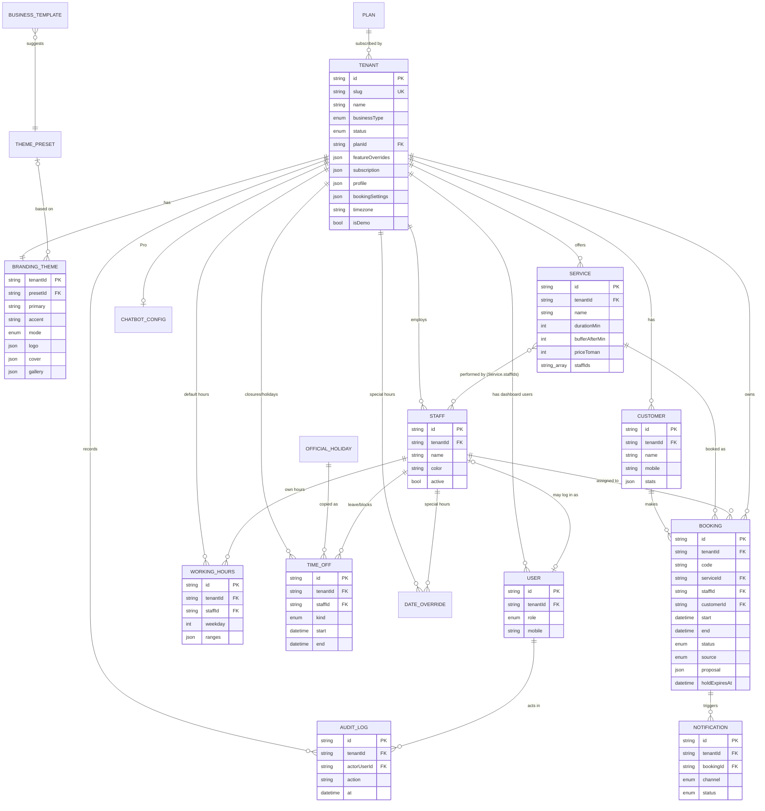
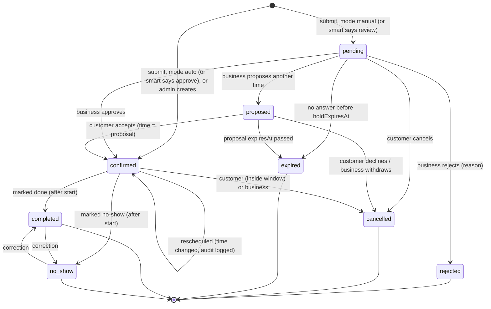
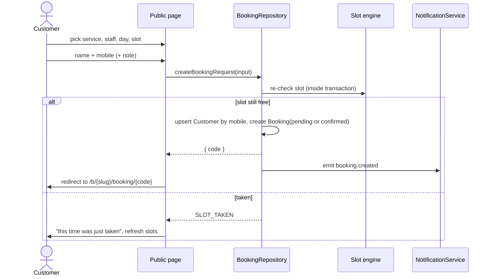
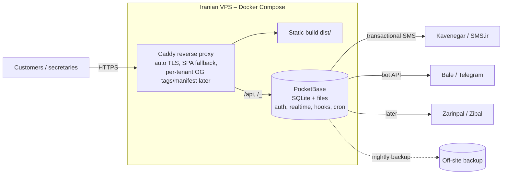

# Architecture — Nubo (نوبو)

> Multi-tenant appointment booking platform for Iranian small businesses, by **GlitchLab Studio**.
> Status: **Phase 1 (architecture) — approved, with founder decisions applied (see §0).**
> Code, identifiers and docs are in English; the product UI is Persian-first (RTL, Jalali, Persian digits).

---

## Table of contents

0. [Founder decisions](#0-founder-decisions)
1. [Product overview, roles, permissions](#1-product-overview-roles-permissions)
2. [Feature list: MVP / Pro / Later](#2-feature-list-mvp--pro--later)
3. [Data model](#3-data-model)
4. [Booking state machine and slot algorithm](#4-booking-state-machine-and-slot-availability-algorithm)
5. [Routes and screens](#5-routes-and-screens)
6. [Folder structure, module boundaries, data adapter](#6-folder-structure-module-boundaries-data-adapter)
7. [Theming and white-label](#7-theming-and-white-label)
8. [Extension points](#8-extension-points)
9. [Hosting and deployment](#9-hosting-and-deployment)
10. [Risks, open questions, Phase 3 build plan](#10-risks-open-questions-phase-3-build-plan)

---

## 0. Founder decisions

Answers to the Phase 1 questions. Where a decision changed something, the section it affects is linked.

| # | Topic | Decision |
|---|---|---|
| D1 | Backend timing | Not decided yet; depends on talks with first clients. When needed, the backend goes on a **VPS** (PocketBase in Docker). The MVP stays a frontend-only demo (§9) |
| D2 | Name and brand | Product: **Nubo (نوبو)**. Studio: **GlitchLab Studio**. No domain yet. **No upfront costs**: infrastructure is paid for from the first sales |
| D3 | Confirmation | **Configurable per business**: manual approval, auto-confirm, or **smart (AI-assisted) auto-confirm** (§4.4) |
| D4 | Customer cancel | Booking code + last 4 digits of mobile in the MVP. SMS verification later |
| D5 | Plans | Basic / Pro split approved. The **"Powered by GlitchLab Studio" footer is shown on every plan**, Pro included. It can't be removed |
| D6 | Business login (demo) | **4-digit PIN** per dashboard user |
| D7 | Demo images | Free-license stock photos bundled in the repo, replaced with real images later (§7.4) |
| D8 | Maps | **Several providers side by side** (Neshan, Balad, Google Maps), behind a small provider registry (§7.6) |
| D9 | Templates | Exactly 7: barbershop, beauty salon, psychologist, dental clinic, general clinic, gym, private tutor |
| D10 | Hosting | **GitHub Pages** for the frontend demo. A VPS later for the backend and shared data (§9) |
| D11 | Psychologist privacy | Nothing extra in the MVP; revisit later |
| D12 | Holidays | **Official Iranian holidays are non-working by default**, and Friday is closed in templates. Owners can **override any holiday**: reopen it, or set special hours for that date (§3.2 `DateOverride`, §4.2) |

---

## 1. Product overview, roles, permissions

### 1.1 What it is

A single web app (one codebase, one deployment) that contains **three apps**:

| App | URL | Who | Purpose |
|---|---|---|---|
| **Public booking page** | `/b/{slug}` | Customers (no account) | See the branded business page, request an appointment, track it |
| **Business dashboard** | `/b/{slug}/admin` | Owner, secretary | Approve requests, run the calendar, manage services, staff, hours, branding |
| **Hub** | `/hub` | Super admin (you) | Create and manage tenants, plans, feature flags, templates, themes; "open as" any business |

There's also a small **landing / demo picker** at `/` that you can open on your phone during a sales visit. It has links to the three demo businesses, their dashboards and the Hub.

Every business is a **tenant**. All tenant data carries a `tenantId`. Each tenant's public page is themed at runtime, so to the end customer it looks like the business's own product.

### 1.2 Stack decision (with trade-offs)

I'm keeping your recommended direction and filling in the gaps:

| Concern | Choice | Why / trade-off |
|---|---|---|
| Build / UI | **React 19 + Vite + TypeScript** | Fast, static output, huge ecosystem, easy for AI-assisted maintenance |
| Styling | **Tailwind CSS v4** + **shadcn/ui** (Radix primitives) | Radix has a `DirectionProvider` for proper RTL. shadcn copies components into the repo, so we own them and can restyle them. Use Tailwind logical utilities (`ms-*`, `pe-*`, `start-*`) so RTL works without hacks |
| Routing | **React Router v7** (library mode, `BrowserRouter`) | Clean URLs for links sent by SMS. Static hosts need an SPA fallback (§9) |
| Server-state | **TanStack Query** over the repository layer | The mock adapter is async too, so going from IndexedDB to network later changes nothing in the UI. Caching and invalidation come free |
| Mock storage | **IndexedDB via Dexie** | localStorage is too small for uploaded logos and gallery images (~5 MB, strings only). Dexie gives transactions, which we need for the "two people book the same slot" check |
| Forms / validation | **react-hook-form + zod** | One zod schema per entity, reused by forms and adapters |
| Dates | **date-fns v4 + `date-fns-jalali` + `@date-fns/tz`**, `Intl.DateTimeFormat('fa-IR-u-ca-persian')` for display | Temporal isn't reliably available on older Android phones yet. Keeping all date math in one `lib/time` module means we can switch later |
| Colors | **culori** (tiny) | Derive a full palette from 1–2 brand colors and check contrast (§7) |
| PWA | **vite-plugin-pwa** (Workbox) | Installable, offline app shell |
| Font | **Vazirmatn** via the `@fontsource-variable/vazirmatn` npm package | Bundled into the build. **No Google Fonts, no CDN** |
| QR | `qrcode` (npm) | Generates PNG/SVG locally |
| Tests | **Vitest** (domain + adapter contract tests), **Playwright** for a few smoke flows | Chromium is available locally |
| Future backend | **PocketBase** (preferred), Supabase as an alternative | PocketBase is a single Go binary with SQLite, auth, files, realtime and an admin UI. It's trivially self-hosted in Docker on an Iranian VPS. Supabase is heavier to self-host, and its cloud may be slow or filtered from Iran |

**Alternatives I considered and rejected:** Next.js (a server-first framework adds complexity and its static export loses its main benefits), and Firebase (Google services are unreliable or blocked in Iran, and it can't be self-hosted).

### 1.3 Roles

| Role | Scope | Description |
|---|---|---|
| `super_admin` | Global | You. Full access to all tenants through the Hub, and can impersonate |
| `owner` | One tenant | Business owner. Full access to that tenant's dashboard, including branding and staff |
| `secretary` | One tenant | Front desk. Handles bookings, customers and availability. Can't change branding, plan or users |
| `staff` *(Later)* | One tenant, own data | A barber or doctor who sees only their own calendar and can block their own time |
| `customer` | One booking | Anonymous. Identified by booking `code` (+ mobile for sensitive actions) |

### 1.4 Permissions matrix

✅ = allowed, 👁 = read only, — = no access, (own) = only own records

| Capability | super_admin | owner | secretary | staff *(Later)* | customer |
|---|:-:|:-:|:-:|:-:|:-:|
| View public page / request booking | ✅ | ✅ | ✅ | ✅ | ✅ |
| Track / cancel own booking (by code) | — | — | — | — | ✅ |
| Inbox: approve / reject / propose time | ✅ | ✅ | ✅ | (own) | — |
| Calendar view | ✅ | ✅ | ✅ | (own) | — |
| Create / edit / reschedule / cancel bookings | ✅ | ✅ | ✅ | (own) | — |
| Mark completed / no-show | ✅ | ✅ | ✅ | (own) | — |
| Availability: hours, breaks, blocks, holidays | ✅ | ✅ | ✅ | (own blocks) | — |
| Booking rules (notice, window, holds) | ✅ | ✅ | 👁 | — | — |
| Services CRUD | ✅ | ✅ | 👁 | 👁 | — |
| Staff CRUD | ✅ | ✅ | 👁 | — | — |
| Customers list / notes | ✅ | ✅ | ✅ | (own customers) | — |
| Branding & texts | ✅ | ✅ | — | — | — |
| Share tools (link, QR) | ✅ | ✅ | ✅ | — | — |
| Stats | ✅ | ✅ | 👁 | — | — |
| Dashboard users (add secretary) | ✅ | ✅ | — | — | — |
| Chatbot settings (Pro) | ✅ | ✅ | — | — | — |
| Plan, features, subscription, suspend | ✅ | 👁 (plan + expiry only) | — | — | — |
| Hub (all tenants, templates, themes) | ✅ | — | — | — | — |
| Impersonate ("open as") | ✅ | — | — | — | — |
| Reset demo data | ✅ | — | — | — | — |

Permissions live in code as a single `can(user, action, resource)` function in `src/domain/auth/permissions.ts`. The UI uses it to hide and disable things. Once a real backend exists, the same rules are mirrored in PocketBase API rules, because the client can't be trusted.

---

## 2. Feature list: MVP / Pro / Later

**MVP** is what you need for a polished demo you can sell from. **Pro** is plan-gated (feature flags exist in the MVP, and some Pro features exist as placeholders). **Later** means not before Phase 4.

### 2.1 From the brief

| Feature | Tier | Notes |
|---|---|---|
| Branded public page (logo, cover, gallery, colors, info, hours, map, socials) | MVP | Gallery flag: Pro (MVP shows it for demo tenants) |
| Service → staff → Jalali day → slot → name + mobile → request | MVP | |
| Tracking page, cancel within window, `.ics` download | MVP | `.ics` is generated client-side |
| Pending holds (configurable) | MVP | |
| Mock login | MVP | 4-digit PIN per user (D6) |
| Inbox: approve / reject with reason / propose time | MVP | |
| Calendar: day / week / list; color by status / service / staff | MVP | Custom lightweight calendar (§10.3, M6) |
| Manual booking, edit, reschedule, cancel, no-show, completed | MVP | |
| Availability: weekly hours per staff, breaks, slot interval, buffers, holidays, one-off blocks, max/day, min notice, max advance | MVP | |
| Services CRUD (name, duration, price, description, image, staff) | MVP | |
| Staff CRUD | MVP | Multi-staff flag: Pro (Basic = 1 staff) |
| Customers list (history, notes, no-shows, tap-to-call) | MVP | |
| Branding settings incl. presets, light/dark | MVP | |
| Share: copy link, QR download, Instagram bio link | MVP | |
| Simple stats | MVP | |
| AI chatbot | Pro | Placeholder UI + interface only, flagged off |
| Hub: tenants CRUD, suspend, slug, plan, flags, subscription, notes, contact | MVP | |
| Impersonate ("open as") | MVP | With banner + audit log |
| Create tenant from template | MVP | Barbershop, beauty salon, psychologist, dental, general clinic, gym, tutor |
| Global overview, theme presets library | MVP | |
| Demo mode: 3 seeded businesses + "reset demo data" | MVP | |

### 2.2 Suggested additions

| Feature | Tier | Why it sells in Iran |
|---|---|---|
| **Confirmation modes**: manual / auto / smart (§4.4) | MVP (manual, auto) · Pro (smart) | Each business chooses how much control it keeps (D3) |
| **"Notify customer" via phone apps**: buttons that open the secretary's SMS app, WhatsApp or Telegram with a ready Persian message (`sms:` / `https://wa.me/` / `tg://` deep links) | MVP | **Free and works today**, before any SMS provider exists. Big selling point |
| **Split shifts** (e.g. 10–14 and 17–22) | MVP | Very common in Iranian shops. The data model supports multiple ranges per day |
| **Official Iranian holidays applied by default** (bundled dataset, solar + lunar), each one overridable by the owner | MVP | Removes setup work on-site. Shows "تعطیل رسمی" (official holiday) on the calendar (D12) |
| **Export bookings / customers to Excel** (CSV with UTF-8 BOM, so Persian opens correctly in Excel) | MVP | Cheap to build, and owners ask for it |
| **Data backup / restore (JSON)** per tenant | MVP | Needed for the mock → real backend migration anyway |
| **Neshan / Balad / Google Maps buttons** + "open in any map app" (`geo:`) | MVP | Iranians mostly use Neshan and Balad (D8, §7.6) |
| **"Powered by GlitchLab Studio" footer** with your contact link on every public page, **on all plans** | MVP | Free marketing to every customer of every client (D5) |
| **Live demo trick**: request in one tab, it appears instantly in the admin inbox in another (BroadcastChannel) | MVP | Very convincing in a sales visit |
| SMS reminders (day before, 2 h before) + confirmation SMS | Pro / Later | Kavenegar / Melipayamak / SMS.ir "verify/lookup" templates |
| Telegram / Bale / Eitaa bot notifications to the business | Pro / Later | Bale and Eitaa work without VPN |
| Customer-side reschedule | Later | |
| **Recurring appointments** (weekly psychology sessions, tutoring) | Later (high priority) | Psychologists and tutors need it. The data model reserves `seriesId` |
| Waitlist (notify when a slot frees up) | Later | |
| Deposit / prepayment (Zarinpal, Zibal, IDPay) | Later | Reduces no-shows for dentists and salons |
| Customer reviews / ratings | Later | |
| Packages / memberships / session credits | Later | Gyms, physiotherapy, laser clinics |
| Group classes with capacity | Later | Gyms, tutors. Model reserves `Service.capacity` |
| Intake forms per service | Later | Clinics, psychologists |
| Birthday / "we miss you" messages | Later | Retention |
| Custom domain per tenant | Later (Pro) | Needs the self-hosted server |
| Multi-branch businesses | Later | |
| No-show protection: auto-flag or block customers with N no-shows | Later (MVP shows the count) | |

---

## 3. Data model

### 3.1 Conventions

- IDs: string (`nanoid` in mock, PocketBase's 15-char IDs later). Treat them as opaque.
- **Every tenant-owned record has `tenantId`.** Repositories always receive the tenant context, and the mock adapter rejects cross-tenant reads and writes, so bugs surface in the demo, not in production.
- Timestamps: **instants are stored as UTC ISO strings** (`2026-10-17T06:30:00.000Z`).
- **Wall-clock rules** (working hours) are stored as local `"HH:mm"` strings plus a weekday, interpreted in the tenant's `timezone` (default `Asia/Tehran`).
- Civil dates (holidays, "day off") are stored as Gregorian `"YYYY-MM-DD"` in tenant time. Jalali exists **only at the UI edge** (display and pickers).
- Weekday numbering follows the Iranian week: `0 = Saturday … 6 = Friday`.
- Money: **integer Toman** (`priceToman: number`). There's no float math. Display formatting is centralized (see Risks: currency redenomination).
- Mobile numbers: stored normalized as `09xxxxxxxxx` (§4.5).
- Images: a `FileRef` (`{ id, url, width, height, mime }`) resolved by a `FileStorage` service (§6.4).
- Every record has `createdAt` and `updatedAt`.

### 3.2 Entities

**Tenant**
| Field | Type | Notes |
|---|---|---|
| id | string | |
| slug | string, unique | `[a-z0-9-]{3,40}`. Reserved words blocked (`admin`, `hub`, `api`…) |
| name | string | Persian display name |
| businessType | enum | `barbershop · beauty_salon · clinic · dental · psychology · gym · tutor · other` |
| status | enum | `active · suspended · trial` |
| planId | `basic \| pro` | |
| featureOverrides | `Partial<Record<FeatureKey, boolean>>` | Overrides the plan defaults |
| subscription | `{ startDate, endDate, priceToman?, note? }` | The status is **derived**: `active`, `expiring` (≤14 days), `expired` |
| contact | `{ name, mobile, email? }` | Your contact person at the business |
| internalNotes | string | Visible in the Hub only |
| timezone | string | Default `Asia/Tehran` |
| profile | TenantProfile (embedded) | Public info |
| bookingSettings | BookingSettings (embedded) | |
| isDemo | boolean | Demo tenants get reset by "reset demo data" |

**TenantProfile** (embedded): `tagline, description, address, city, location { lat?, lng?, mapLinks: Partial<Record<MapProviderId, string>> } (see §7.6), phones[], socials { instagram?, telegram?, whatsapp?, bale?, eitaa?, website? }, bookingRulesText, footerText`.

**BookingSettings** (embedded)
| Field | Default | Meaning |
|---|---|---|
| slotIntervalMin | 30 | Grid step for candidate start times (15/20/30/60) |
| defaultBufferMin | 0 | Gap after each appointment (a service may override it) |
| minNoticeMin | 120 | Can't book a slot starting sooner than now + this |
| maxAdvanceDays | 30 | How far ahead customers can book |
| maxBookingsPerDay | null | Per staff. Null = unlimited |
| confirmationMode | `manual` | `manual` (secretary approves) · `auto` (straight to `confirmed`) · `smart` (policy decides per request, Pro). See §4.4 |
| smartRules | defaults | Settings for `smart` mode: e.g. `requireKnownCustomer`, `maxNoShows`, `blockFirstVisit`, `minHoursAhead`. See §4.4 |
| holdPendingSlots | true | Pending requests block the slot for others |
| pendingExpiryHours | 24 | Unanswered pending requests expire (and free the slot) after this |
| cancellationWindowHours | 12 | Customer can cancel until start − this |
| allowStaffChoice | true | Show the staff picker. Otherwise, or with "any", the system assigns staff |
| requireCustomerNote | false | |

**Plan** (static config in code for MVP, a collection later): `id, name, features: FeatureKey[], limits { maxStaff, maxServices, maxGalleryImages }`.

`FeatureKey = 'multiStaff' | 'gallery' | 'chatbot' | 'sms' | 'messengerBots' | 'customDomain' | 'smartConfirm' | 'advancedStats' | 'exportData'`

> There's deliberately **no** feature to remove the "Powered by GlitchLab Studio" footer (D5).

Effective features = `plan.features` ⊕ `tenant.featureOverrides`, computed by a single `getFeatures(tenant)` function.

**BrandingTheme** (1:1 with tenant): `tenantId, presetId?, primary, accent, mode ('light'|'dark'|'auto'), radius ('none'|'sm'|'md'|'lg'|'full'), logo?: FileRef, cover?: FileRef, gallery: FileRef[], customCss? (Later)`.

**ThemePreset** (global): `id, name, nameFa, primary, accent, mode, radius, suggestedFor: businessType[]`.

**BusinessTemplate** (global): `id, nameFa, businessType, services: ServiceDraft[], weeklyHours: WeeklyHoursDraft, bookingSettings: Partial<BookingSettings>, themePresetId, profileTexts { tagline, description, bookingRulesText }`.

**Staff**: `id, tenantId, name, title, photo?: FileRef, mobile?, color, active, sortOrder, userId?`.

**Service**: `id, tenantId, name, description, category?, durationMin, bufferAfterMin? (null = tenant default), priceToman?, priceType ('fixed'|'from'|'free'|'hidden'), image?: FileRef, staffIds: string[], color, active, sortOrder, capacity (=1, reserved for group classes)`.
> **Single source of truth** for the staff ↔ service relation is `Service.staffIds`.

**WorkingHours**: `id, tenantId, staffId (null = business default), weekday (0–6), ranges: { start: "HH:mm", end: "HH:mm" }[]`.
> **Breaks are gaps between ranges.** `10:00–13:00, 14:00–20:00` means a 13–14 break. The UI shows an "add break" button that splits a range. An empty `ranges` means closed. A staff member with no rows inherits the business default.

**TimeOff** (blocks, leave, closures, holidays): `id, tenantId, staffId (null = whole business), kind ('holiday'|'closure'|'leave'|'block'), start, end (UTC instants; an all-day item spans local 00:00 → 24:00), allDay, reason?, source ('manual'|'official_holiday'), officialHolidayKey?, disabled: boolean`.
> **Official holidays are copied into each tenant as `TimeOff` rows** (`source = 'official_holiday'`) when the tenant is created, and again when a new year's dataset ships. The owner **overrides** one by setting `disabled = true` ("we're open that day"). We keep the row instead of deleting it, so the next dataset sync doesn't add it back.

**DateOverride** (special hours for one date): `id, tenantId, staffId (null = business), date: CivilDate, ranges: { start, end }[], note?`.
> Replaces the weekly `WorkingHours` for that date only. Typical uses: "open 10–14 on this holiday", "close early on the last Wednesday of the year". An empty `ranges` means closed that date.

**OfficialHoliday** (global, bundled dataset, read-only): `key, date: CivilDate, jalaliLabel, titleFa, kind ('solar'|'lunar')`. Shipped as `seed/holidays/1405.json`, `1406.json`.

**Customer**: `id, tenantId, name, mobile (unique per tenant), notes, tags[], stats { bookings, completed, noShows, cancelled, lastVisitAt } (denormalized, recomputed on booking change), blocked: boolean`.
> Customers are created or matched automatically by `(tenantId, mobile)` when a booking is submitted.

**Booking**
| Field | Type | Notes |
|---|---|---|
| id | string | |
| tenantId | string | |
| code | string | Public tracking code, 8 chars from an unambiguous alphabet (no 0/O/1/I). Unique per tenant |
| serviceId, staffId, customerId | string | |
| start, end | UTC instant | `end = start + durationMin` (buffer **not** included) |
| durationMin, bufferAfterMin | number | **Snapshot** at booking time, so editing a service doesn't move old bookings |
| serviceName, priceToman | snapshot | Same reason |
| customerName, customerMobile | snapshot | The customer record may be edited later |
| status | BookingStatus | See §4.1 |
| source | `online \| phone \| walk_in \| chatbot \| admin` | |
| customerNote, internalNote | string | |
| statusReason | string? | Rejection or cancellation reason shown to the customer |
| cancelledBy | `customer \| business \| system`? | |
| proposal | `{ start, end, staffId, message?, expiresAt }`? | Set while `status = proposed` |
| holdExpiresAt | instant? | For `pending`: when the request auto-expires |
| seriesId | string? | Reserved for recurring appointments |
| statusChangedAt | instant | |

**User**: `id, tenantId (null for super_admin), role, name, mobile, staffId?, active, pinHash? (mock only)`.

**Notification** (outbox): `id, tenantId, bookingId?, event, channel ('in_app'|'sms'|'telegram'|'bale'|'manual_share'), recipient, body, status ('simulated'|'queued'|'sent'|'failed'), error?, createdAt`.
> In the MVP every message is written with status `simulated`, so you can show prospects "this SMS would have been sent".

**AuditLog**: `id, tenantId?, actorUserId, actorRole, impersonatorUserId?, action ('booking.approve', 'tenant.suspend', …), entity, entityId, summary, diff?, at`.

**ChatbotConfig** (Pro, placeholder): `tenantId, enabled, greeting, faq: {q,a}[], tone, providerId`.

### 3.3 ER diagram



---

## 4. Booking state machine and slot-availability algorithm

### 4.1 Status state machine



Rules:
- Transitions are defined **once** in `src/domain/booking/stateMachine.ts` as a table `{ from, to, actor[] , guard? }`. Every adapter calls `assertTransition()` before writing.
- **Blocking statuses** (they occupy time in the slot engine): `confirmed` always; `pending` only if `holdPendingSlots` is on and `holdExpiresAt > now`; `proposed` blocks the **proposed** time (not the original).
- **Expiry is computed lazily.** The MVP has no background jobs, so a `pending` request with `holdExpiresAt < now` is treated as `expired` by the slot engine immediately, and is persisted as `expired` the next time anything reads it. In Phase 4 a PocketBase cron makes it real.
- Customer cancel guard: `now ≤ start − cancellationWindowHours`. Outside the window the tracking page shows "please call the business" with a tap-to-call button.
- `completed` / `no_show` are only allowed when `start ≤ now`.
- Each transition writes an `AuditLog` entry and emits a domain event (`booking.confirmed`, …) that the NotificationService listens to (§8.1).

### 4.2 Slot-availability algorithm

Lives in `src/domain/slots/` as **pure functions** (no I/O, no React, no `Date.now()` inside; `now` is passed in). That makes it fully unit-testable, and portable to a server hook later.

**Inputs**

```ts
interface SlotQuery {
  date: CivilDate;                 // "2026-10-20" in tenant tz (from a Jalali pick in the UI)
  service: Service;
  staffId: string | 'any';
  now: Instant;
  tz: string;                      // "Asia/Tehran"
  settings: BookingSettings;
  staff: Staff[];                  // active staff who can perform the service
  workingHours: WorkingHours[];    // business default + per staff
  timeOff: TimeOff[];              // overlapping the date
  bookings: Booking[];             // overlapping the date (any status; filtered inside)
  excludeBookingId?: string;       // when rescheduling, ignore the booking being moved
}
interface Slot { start: Instant; end: Instant; staffIds: string[] } // staff free at that time
```

**Steps (per candidate staff member)**

1. **Pick staff.** If `staffId = 'any'`, use all active staff in `service.staffIds`. Otherwise use only that one.
2. **Day-level rejects.** Skip if the date is before today (tenant tz) or after `today + maxAdvanceDays`, if a business-wide all-day `holiday`/`closure` covers it (ignoring rows with `disabled = true`), or if the staff member has an all-day `leave`.
   *Exception:* a `DateOverride` for that date wins over a holiday. Setting special hours on a holiday means "we're open".
3. **Open intervals.** Use, in priority order: the staff's `DateOverride` for that date, the business `DateOverride`, the staff's `WorkingHours` for that weekday, then the business default. Convert each `"HH:mm"` range to UTC instants using the tenant timezone **for that specific date**. Never add a fixed +3:30 offset, so we stay correct if DST ever returns.
4. **Subtract unavailability.** Remove business-wide and staff-specific `TimeOff` intervals.
5. **Subtract busy time.** For each **blocking** booking of that staff member (§4.1), subtract `[b.start, b.end + b.bufferAfterMin)`. **The buffer belongs to the earlier appointment.**
6. **Daily cap.** If `maxBookingsPerDay` is set and the staff member already has that many blocking bookings that day, there are no slots.
7. **Generate candidates.** Inside each remaining free interval, walk a grid of `slotIntervalMin` **anchored to the start of the original working range** (so a shift starting at 10:15 gives 10:15, 10:45, … rather than 10:30). A candidate `t` is valid if `[t, t + duration + buffer)` fits entirely inside the free interval.
   *Trade-off:* when the new appointment's own buffer runs past the end of the shift, we still reject it. That's a simple, predictable rule, and owners can set the buffer to 0 at the end of the day if they want.
8. **Notice filter.** Drop candidates with `t < now + minNoticeMin`.
9. **Merge across staff.** Group by start time. Each slot lists which staff are free. For `'any'`, the slot is shown once.
10. **Assign staff (on submit, for "any").** Pick the free staff member with the fewest bookings that day, with `sortOrder` as tie-breaker. That spreads load fairly and is deterministic.

**Interval math** is a tiny internal helper (`subtract`, `intersect`, `merge` on `[start, end)` half-open intervals in epoch ms). Half-open means a booking ending at 11:00 and one starting at 11:00 **don't overlap**.

**Edge cases handled**

| Case | Handling |
|---|---|
| Overlapping bookings created manually by admin | Allowed **with a warning** ("overlaps with X"). Admins sometimes double-book on purpose. The slot engine just sees less free time |
| Double submit race (two customers, same slot) | `createBookingRequest` **re-runs the availability check inside a write transaction** (Dexie transaction in mock, a PocketBase hook later) and fails with `SLOT_TAKEN`. The UI then refreshes the slots and says "this time was just taken" |
| Pending holds | See blocking statuses. Expired holds are ignored immediately |
| Rescheduling | `excludeBookingId` stops a booking from blocking itself |
| Service duration changed after booking | The booking keeps its snapshot `durationMin` and buffer |
| Staff removed from a service | Existing bookings stay. New slots aren't offered |
| Timezone | All math happens in UTC instants. Conversion only at "HH:mm on date D in tz" and at display. Iran has used fixed UTC+3:30 since 2022, but we still use the IANA zone |
| A customer's phone set to a different timezone | We always display in **tenant** time. A foreign-timezone customer sees Tehran times, with a small "Tehran time" label |
| Jalali conversion | The UI calendar builds the Jalali month grid with `date-fns-jalali`. Each cell maps to a Gregorian `CivilDate` that goes to the engine. **The engine never sees Jalali** |
| Shifts past midnight (barber until 01:00) | **Not in MVP.** Ranges must end ≤ 24:00. Workaround: 22:00–24:00 on day N plus 00:00–01:00 on day N+1. Proper support later |
| Today, late in the day | The notice filter removes past and near times. If nothing is left, the day shows as "full" |
| Calendar month view performance | `getAvailableDays(month)` runs the same engine per day but stops at the first slot found. That's ~30 cheap runs, fine on a phone |

### 4.3 Booking submission flow



### 4.4 Confirmation modes and smart auto-confirm

Each business picks a `confirmationMode` (D3). The decision happens in **one place**, a pure function behind an interface, called by `createRequest` after the slot check passes:

```ts
interface ConfirmationPolicy {
  decide(i: { booking: BookingDraft; customer: Customer | null; tenant: Tenant; history: CustomerHistory; now: Instant })
    : Promise<{ decision: 'approve' | 'review'; reasons: string[] }>;   // reasons are shown to the secretary
}
```

| Mode | Policy | Tier |
|---|---|---|
| `manual` | Always `review` → `pending`, lands in the inbox | MVP |
| `auto` | Always `approve` → `confirmed` | MVP |
| `smart` | `RulesConfirmationPolicy` now; `AiConfirmationPolicy` later | Pro (`smartConfirm`) |

**Smart mode, MVP (rules, deterministic):** approve only when all enabled rules pass, otherwise send it to review with the reasons. Example rules:
- customer is known (≥ 1 completed booking) — or first visits are allowed;
- customer's no-shows ≤ `maxNoShows` and the customer isn't blocked;
- slot is at least `minHoursAhead` away;
- the service is one the owner marked "safe to auto-confirm";
- the customer doesn't already have another active booking that day.

The secretary sees *why* a request was or wasn't auto-confirmed (e.g. "first visit → needs review"), and every automatic decision is audit-logged with `actor = system`.

**Smart mode, Later (AI-assisted):** an `AiConfirmationPolicy` uses the same interface. It gets the rule results plus aggregated history (no-show patterns, typical booking times, how the secretary handled similar requests) and returns `approve` / `review` with a Persian explanation. Guardrails:
- it can only **approve or escalate, never reject**; a human always makes rejections;
- the hard rules (slot free, within hours, customer not blocked) are checked first and can't be overridden;
- if the AI provider fails, it falls back to the rules policy.

That way "AI-assisted" is safe to sell: the worst case is that a request goes to the inbox as it would anyway.

### 4.5 Persian input normalization (part of the domain layer)

- **Digits:** every input accepts Persian (`۰–۹`), Arabic (`٠–٩`) and Latin digits, and normalizes them to Latin before validation and storage. Display converts to Persian digits with `toFaDigits()` / `Intl.NumberFormat('fa-IR')`.
- **Characters:** normalize Arabic `ي`/`ك` to Persian `ی`/`ک` in names and search, so customer search works.
- **Mobile:** strip spaces and dashes, convert `+98…`, `0098…`, `98…`, `9…` to `09…`, then validate against `^09\d{9}$`.
- **Prices:** `۱۵۰٬۰۰۰ تومان`, formatted by one `formatToman()` helper.

---

## 5. Routes and screens

Mobile-first everywhere. The dashboard uses a **bottom tab bar** on phones and a side nav on wider screens.

### 5.1 Public / landing

| Route | Screen | Description |
|---|---|---|
| `/` | Landing / demo picker | Your sales page: what the product does, plus cards for the 3 demo businesses (public page, dashboard, Hub). Persian |
| `/b/:slug` | Business page | Cover, logo, name, tagline, description, gallery, services with prices, staff, working hours (Jalali weekday names, today highlighted), address + map buttons, socials, booking rules, a sticky "رزرو نوبت" (book) button. Suspended tenant: friendly "temporarily unavailable" page |
| `/b/:slug/book` | Booking wizard | Steps: ① service ② staff (skipped if 1 staff or `allowStaffChoice = false`; has an "any" option) ③ Jalali calendar with available days ④ slot grid grouped as morning / afternoon / evening ⑤ name, mobile, note + rules ⑥ review & submit. State lives in the URL query, so back/forward and refresh work |
| `/b/:slug/booking/:code` | Tracking page | Status badge and timeline, details, **cancel** (inside window, confirms with last 4 mobile digits), **accept / decline proposal**, add to calendar (.ics), tap-to-call the business, "book again" |
| `/b/:slug/admin/login` | Business login | Choose your name, then enter a **4-digit PIN** (mock). Demo PINs are shown on the landing page |

### 5.2 Business dashboard (`/b/:slug/admin/...`)

| Route | Screen | Description |
|---|---|---|
| `/` (home) | **Today + Inbox** | Pending requests first (approve / reject / propose as large tap targets), then today's agenda, plus quick stats chips. A badge shows the pending count |
| `/inbox` | Requests inbox | Full list of pending and proposed requests, filters, bulk approve |
| `/calendar` | Calendar | Day view (staff columns), week view (7 day columns, Saturday first), list view. Color by status / service / staff. Tap an empty slot for a new booking. Tap a booking for details. Jalali header and date picker |
| `/bookings/new` | New booking | Walk-in or phone. Customer search by name or mobile (or create new), service, staff, time (slot picker **or** free time with overlap warning), source, note |
| `/bookings/:id` | Booking detail | All fields, status actions per the state machine, reschedule, notify customer (SMS / WhatsApp / Telegram deep links), history from the audit log |
| `/customers` | Customers | Search, tags, no-show badge |
| `/customers/:id` | Customer detail | Booking history, notes, tap-to-call, new booking for this customer, block |
| `/services` | Services | List + editor (name, duration, buffer, price type, image, staff, active, order) |
| `/staff` | Staff | List + editor (photo, title, color, services, own hours, leave). Single-staff UX on Basic |
| `/availability` | Availability | Weekly hours grid (business + per staff), break splitting, **holidays list** (official holidays on by default; toggle "open this day" or set special hours), date overrides, closures, one-off blocks |
| `/settings/booking` | Booking rules | Slot interval, notice, max advance, max per day, confirmation mode (manual / auto / smart + rules), pending hold + expiry, cancellation window, rules text |
| `/settings/branding` | Branding | Preset picker, primary/accent colors, light/dark, radius, logo / cover / gallery upload (auto-compressed), texts, socials. **Live preview** of the public page |
| `/settings/users` | Users | Owner adds or removes secretaries (mock) |
| `/share` | Share tools | Copy link, QR (PNG/SVG download, print-ready card with logo), Instagram bio link tips, WhatsApp/Telegram share |
| `/stats` | Stats | Bookings this week/month, approval rate, no-show rate, busiest hours heatmap, top services |
| `/notifications` | Outbox | Simulated messages log ("would send SMS: …") |
| `/chatbot` | AI assistant (Pro) | Placeholder: "coming soon" plus FAQ / greeting editor, behind the feature flag. Locked with an upsell when the flag is off |
| `/plan` | Plan & subscription | Read-only: plan, expiry, features. "Contact support to upgrade" |

When impersonating, a persistent banner shows: "شما به عنوان {business} وارد شده‌اید — بازگشت به هاب" (you're signed in as {business}; back to Hub).

### 5.3 Hub (`/hub/...`)

| Route | Screen | Description |
|---|---|---|
| `/hub/login` | Login | Mock super-admin login |
| `/hub` | Overview | Tenant count, active / expiring / expired subscriptions, bookings today/week (global), recently created tenants, expiring-soon list with call links |
| `/hub/tenants` | Tenants | Search, filter by status / plan / type / expiry. Row actions: open public page, **open as**, suspend |
| `/hub/tenants/new` | New tenant wizard | ① pick template ② name + slug (auto-suggested from a Persian-name transliteration, editable, uniqueness check) ③ contact + plan + subscription dates ④ theme preset + logo ⑤ done: show link + QR. **Goal: under 3 minutes on-site** |
| `/hub/tenants/:id` | Tenant detail | Profile, plan, feature flag toggles, subscription, notes, users, stats, danger zone (suspend, delete, export JSON) |
| `/hub/templates` | Templates | View and edit business templates |
| `/hub/themes` | Theme presets | Preset library with live preview |
| `/hub/audit` | Audit log | Global log, filter by tenant |
| `/hub/settings` | Settings | **Reset demo data**, export/import all data, app info |

### 5.4 Route guards

`RequireTenant` (loads tenant by slug: 404 if unknown, suspended page if suspended), `RequireRole(roles)`, `RequireFeature(key)` (shows the upsell instead of a hard block).

---

## 6. Folder structure, module boundaries, data adapter

### 6.1 Folder structure

```
booking-platform/
├─ docs/                     ARCHITECTURE.md, DESIGN.md (Phase 2)
├─ public/
│  ├─ demo/                  bundled demo images (logos, covers, staff photos)
│  └─ icons/                 PWA icons
├─ src/
│  ├─ main.tsx               bootstrap: providers, router
│  ├─ app/                   router, providers (Query, Data, Auth, Direction, Theme), layouts, guards
│  ├─ features/              UI by app → screen. May import: ui, domain, data/hooks, services, lib
│  │  ├─ landing/
│  │  ├─ public/             business page, booking wizard, tracking
│  │  ├─ dashboard/          inbox, calendar, bookings, customers, services, staff, availability, settings, share, stats, chatbot
│  │  └─ hub/                overview, tenants, templates, themes, audit, settings
│  ├─ ui/                    design system: shadcn components + our primitives (JalaliCalendar, SlotGrid, PriceText, PhoneInput, StatusBadge…)
│  ├─ domain/                PURE TypeScript. No React, no storage, no Date.now()
│  │  ├─ types.ts            entity types (inferred from zod schemas in schemas.ts)
│  │  ├─ schemas.ts
│  │  ├─ booking/            stateMachine.ts, code.ts, ics.ts
│  │  ├─ slots/              intervals.ts, engine.ts, engine.test.ts
│  │  ├─ tenant/             features.ts, subscription.ts, slug.ts
│  │  ├─ auth/               permissions.ts
│  │  └─ stats/              aggregations
│  ├─ data/
│  │  ├─ ports.ts            repository interfaces + DataAdapter (the contract)
│  │  ├─ errors.ts           DataError codes (NOT_FOUND, SLOT_TAKEN, FORBIDDEN, CONFLICT, VALIDATION)
│  │  ├─ hooks/              TanStack Query hooks: useBookings, useCreateBooking… (the ONLY thing features use)
│  │  ├─ adapters/
│  │  │  ├─ mock/            dexie db, repositories, broadcast realtime, seed loader
│  │  │  └─ pocketbase/      Phase 4
│  │  ├─ contract.test.ts    one test suite every adapter must pass
│  │  └─ index.ts            createDataAdapter(env)
│  ├─ services/              extension points: interface + mock implementation each
│  │  ├─ auth/  notifications/  files/  payments/  chatbot/  events/
│  ├─ seed/                  demo tenants, templates, theme presets, holidays/ (1405.json, 1406.json)
│  ├─ theme/                 token derivation (culori), ThemeScope, presets types
│  ├─ lib/                   time (tz + jalali), digits, phone, money, persian text normalization, csv
│  ├─ i18n/                  fa.ts string dictionary (Persian only now; structure allows en later)
│  └─ styles/                tailwind entry, fonts
├─ .github/workflows/        deploy.yml (Phase 3)
└─ package.json, vite.config.ts, tsconfig.json …
```

### 6.2 Boundary rules (enforced by ESLint `no-restricted-imports`)

1. `domain/` imports nothing from the app (only zod and date-fns).
2. `features/` **never** import `data/adapters/*` or Dexie. They use `data/hooks` only.
3. `data/adapters/*` implement `data/ports.ts` and may use `domain/`.
4. `ui/` is generic. It doesn't know about tenants or repositories.
5. All user-facing strings come from `i18n/fa.ts`. There are no Persian literals inside components (it keeps the code readable for AI tools, and makes typos easy to fix).

### 6.3 The data adapter interface

```ts
// src/data/ports.ts (abridged)
export interface TenantContext { tenantId: string; actor: Actor }   // actor = user or 'public'

export interface TenantRepository {
  getBySlug(slug: string): Promise<PublicTenant | null>;  // public-safe projection
  get(id: string): Promise<Tenant>;
  list(filter?: TenantFilter): Promise<Tenant[]>;          // super_admin only
  create(input: NewTenant, fromTemplateId?: string): Promise<Tenant>;
  update(id: string, patch: Partial<Tenant>): Promise<Tenant>;
  isSlugAvailable(slug: string): Promise<boolean>;
}

export interface BookingRepository {
  listRange(ctx: TenantContext, range: { from: Instant; to: Instant }, filter?: BookingFilter): Promise<Booking[]>;
  get(ctx: TenantContext, id: string): Promise<Booking>;
  getByCode(slug: string, code: string): Promise<PublicBooking | null>;
  createRequest(slug: string, input: BookingRequestInput): Promise<{ code: string }>;   // public, re-validates slot
  createManual(ctx: TenantContext, input: ManualBookingInput): Promise<Booking>;
  transition(ctx: TenantContext, id: string, to: BookingStatus, payload?: TransitionPayload): Promise<Booking>;
  reschedule(ctx: TenantContext, id: string, start: Instant, staffId?: string): Promise<Booking>;
  customerAction(slug: string, code: string, action: 'cancel' | 'acceptProposal' | 'declineProposal', mobileLast4: string): Promise<PublicBooking>;
}

export interface AvailabilityRepository {
  // returns everything the slot engine needs for a date range, in one call
  getSlotInputs(slug: string, range: { from: CivilDate; to: CivilDate }, serviceId: string): Promise<SlotInputs>;
}

export interface DataAdapter {
  tenants: TenantRepository;
  branding: BrandingRepository;
  services: ServiceRepository;
  staff: StaffRepository;
  hours: WorkingHoursRepository;
  timeOff: TimeOffRepository;
  customers: CustomerRepository;
  bookings: BookingRepository;
  availability: AvailabilityRepository;
  notifications: NotificationRepository;
  audit: AuditRepository;
  presets: ThemePresetRepository;
  templates: TemplateRepository;
  /** realtime: callback on any change in a tenant's collection (mock: BroadcastChannel; PB: realtime SSE) */
  subscribe(topic: { tenantId: string; collection: 'bookings' | '*' }, cb: () => void): Unsubscribe;
  /** demo / migration tools */
  admin: { resetDemo(): Promise<void>; exportAll(): Promise<Backup>; importAll(b: Backup): Promise<void> };
}
```

Key decisions:
- **Public methods take a `slug`, private methods take a `TenantContext`.** That mirrors how a real API would separate anonymous and authenticated calls. Public methods return **projections** (`PublicTenant`, `PublicBooking`) that exclude internal notes, the full mobile number, and so on.
- **The slot engine runs on the client in both modes.** The adapter only fetches its inputs. The **authoritative re-check happens inside `createRequest`** (mock: same engine, inside a Dexie transaction; PocketBase: a hook doing an overlap query + unique constraint).
- Errors are typed (`DataError` with `code`), so the UI can show friendly Persian messages.

### 6.4 How the mock → real backend swap works

1. `createDataAdapter()` reads `import.meta.env.VITE_DATA_ADAPTER` (`mock` | `pocketbase`). It's the **only** place adapters are wired in.
2. `data/contract.test.ts` is a shared test suite (create a tenant, book, race two requests, transitions, tenant isolation…). It runs against the mock in CI now, and against a throwaway PocketBase container later. When the PocketBase adapter passes it, the UI works unchanged.
3. PocketBase collections mirror §3 one-to-one. Embedded objects become `json` fields; `FileRef` fields become PocketBase `file` fields. API rules enforce tenant isolation (`tenantId = @request.auth.tenantId`). Public reads go through narrow rules or custom routes.
4. Booking creation gets a server-side hook (`onRecordCreateRequest` in `pb_hooks/*.pb.js`) that rejects overlaps for blocking statuses, and a cron that expires stale pending requests.
5. Data migration: **export JSON** from the mock (Hub → Settings) → a small Node script → PocketBase import.
6. `FileStorage` swaps from "Blob in IndexedDB → object URL" to "PocketBase file URL" behind the same `FileRef`.

---

## 7. Theming and white-label

### 7.1 Three visual scopes

| Scope | Theme |
|---|---|
| Public page (`/b/:slug`, booking, tracking) | **Fully tenant-branded** |
| Business dashboard | Neutral product UI with the **tenant's primary color as accent**, plus logo in the header. Readable and consistent, still feels like theirs |
| Hub + landing | **Your** product brand (defined in Phase 2) |

### 7.2 Theme tokens

Tenants store only a few **seed values** (`primary`, `accent`, `mode`, `radius`). `theme/derive.ts` uses culori to compute the full token set in OKLCH:

```
--color-primary, --color-primary-fg, --color-primary-soft, --color-primary-strong
--color-accent,  --color-accent-fg
--color-bg, --color-surface, --color-surface-2, --color-border
--color-text, --color-text-muted
--color-success, --color-warning, --color-danger (fixed, not tenant-controlled)
--status-pending, --status-confirmed, … (fixed; status colors must stay recognizable)
--radius
```

- **Contrast safety:** foreground colors are chosen automatically (white or near-black) to meet WCAG AA against the brand color. If a tenant picks a very light primary, we darken the "strong" variant used for text links.
- **Light / dark:** dark mode is derived from the same seeds (surfaces from a dark neutral, primary lightened). `auto` follows the device.
- **Application:** a `<ThemeScope theme={…}>` component sets the CSS variables on its wrapper `div` (not on `:root`), so the dashboard's live branding preview can show the tenant theme inside the page. Tailwind v4's `@theme` maps utilities (`bg-primary`, `text-muted`) to these variables.
- `<meta name="theme-color">` updates to the tenant primary on public pages, so the mobile browser bar matches the brand.

### 7.3 Presets

A global library of about 10 presets in `seed/themePresets.ts`, editable in the Hub (e.g. "کلاسیک باربر" classic barber in charcoal + gold, "آرامش" calm clinic in sage, "دندان" dental mint, "رز" rose salon, "اقیانوس" ocean blue, "شب" dark elegant…). Each template suggests a preset. Choosing a preset copies its seeds, and the owner can then tweak them.

### 7.4 Logo and images

- Uploads are **resized and compressed in the browser** (canvas → WebP; logo max 512 px, cover 1600 px, gallery 1200 px, staff photo 400 px). They're stored via `FileStorage`. The mock saves Blobs in IndexedDB.
- If there's no logo, we generate a monogram avatar (the business's first Persian letter on the primary color).
- Covers have a dark gradient overlay so text on top stays readable whatever the image.
- Demo images are **free-license stock photos** (Unsplash / Pexels licenses allow commercial use without attribution), resized and bundled in `/public/demo`. Every file's source and license is recorded in `public/demo/CREDITS.md`, so they're easy to replace with real client photos later (D7).

### 7.5 Known white-label limits of a static SPA (resolved in Phase 4)

- **Link previews** (Telegram / WhatsApp / Instagram) can't show per-business title and image without a server, because crawlers don't run JS. They'll show the generic app preview. Fix: a server renders `<meta og:*>` per slug.
- **"Add to home screen" per business:** the PWA manifest is per-app, so the installed icon is the platform's. Fix: a server-generated per-tenant manifest.
- **Custom domains**: need the server or reverse proxy.

---

### 7.6 Map providers (D8)

Maps are **links, not embedded maps**. Embedded map SDKs need API keys, add weight, and some are blocked in Iran. Each provider is a small entry in a registry:

```ts
type MapProviderId = 'neshan' | 'balad' | 'google';
interface MapProvider {
  id: MapProviderId; labelFa: string; icon: string;
  linkFor(loc: { lat: number; lng: number }): string;   // build a link from coordinates
  parseLink?(url: string): { lat: number; lng: number } | null;  // let the owner paste a share link
}
```

- The owner can either **paste share links** from each app (stored as-is in `location.mapLinks`), or **set a pin once** (lat/lng). The registry then builds a link for every provider.
- The public page shows one button per available provider, plus **"open in another map app"** (`geo:lat,lng`), which on Android lets the customer pick any installed app.
- Adding another provider later (e.g. Waze) is one registry entry. Exact URL formats for each app are verified during Phase 3, because they change without notice.
- The `/hub` and admin forms only need lat/lng or links, never an API key.

---

## 8. Extension points

Every service is an **interface + a mock implementation**, wired in `app/providers`. Phase 4 adds real implementations without touching features.

### 8.1 Domain events + notifications

```ts
type DomainEvent =
  | { type: 'booking.created' | 'booking.confirmed' | 'booking.rejected' | 'booking.proposed'
        | 'booking.cancelled' | 'booking.rescheduled' | 'booking.expired'; booking: Booking }
  | { type: 'booking.reminder'; booking: Booking; offsetMin: number };   // Phase 4 (needs server cron)

interface NotificationChannel {
  id: 'sms' | 'telegram' | 'bale' | 'in_app';
  send(msg: { tenantId: string; to: string; templateKey: string; vars: Record<string, string> }): Promise<SendResult>;
}
interface NotificationService { handle(e: DomainEvent): Promise<void> }   // routes events → channels per tenant config
```

- An `EventBus` (`services/events`) publishes domain events after successful writes. `NotificationService` subscribes.
- **Templates** are Persian with variables (`{customerName} عزیز، نوبت شما برای {service} در {date} ساعت {time} تایید شد.`, i.e. "Dear {customerName}, your {service} appointment on {date} at {time} is confirmed."). They're keyed so they map onto Kavenegar / SMS.ir **pre-approved "lookup/verify" templates**, which Iranian providers require for transactional SMS.
- **MVP:** a `SimulatedChannel` writes to the Notification outbox with status `simulated`, plus an in-app badge for the business. Also the **manual share** helpers (`sms:`, `wa.me`, Telegram) that open the secretary's own phone apps. They're free and real.
- **Phase 4 (server-side):** sending moves to PocketBase hooks, so API keys never reach the browser. The client-side bus then only drives UI refresh.

### 8.2 Auth / OTP

```ts
interface AuthProvider {
  current(): Promise<Session | null>;
  signInWithPin?(tenantSlug: string, userId: string, pin: string): Promise<Session>;  // mock
  requestOtp(mobile: string): Promise<{ ttlSec: number }>;
  verifyOtp(mobile: string, code: string): Promise<Session>;
  signOut(): Promise<void>;
  impersonate(tenantId: string): Promise<Session>;   // super_admin only, audit-logged
  stopImpersonation(): Promise<Session>;
}
```

- **MVP:** `MockAuthProvider`. The session lives in `sessionStorage`. Login is name + 4-digit PIN (PINs are hashed in the mock DB; demo PINs are listed on the landing page). The OTP flow is simulated: the code is shown on screen, which is fine for the demo.
- **Phase 4:** PocketBase auth collection `users` with a custom SMS-OTP route (PocketBase's built-in OTP is email-based; we add a hook that sends the code via the SMS channel). Customer OTP is optional later, to confirm a booking's mobile number and cut fake bookings.

### 8.3 Payments (Later)

```ts
interface PaymentProvider {
  id: 'zarinpal' | 'zibal' | 'idpay';
  createPayment(i: { tenantId; bookingId; amountToman; callbackUrl; description }): Promise<{ redirectUrl: string; authority: string }>;
  verify(authority: string, amountToman: number): Promise<{ ok: boolean; refId?: string }>;
}
```
This must run server-side (merchant keys). Booking gets `deposit { amountToman, status, refId }` (reserved, not in MVP). Iranian gateways usually need the merchant's own business registration (اینماد / enamad trust seal), so per-tenant merchant IDs are likely. That's an open question.

### 8.4 AI chatbot (Pro)

```ts
interface ChatbotProvider {
  id: string;
  reply(i: {
    tenant: PublicTenant; config: ChatbotConfig;
    messages: { role: 'user' | 'assistant'; text: string }[];
    tools: ChatbotTools;      // the bot acts only through these
  }): AsyncIterable<ChatChunk>;
}
interface ChatbotTools {
  getBusinessInfo(): Promise<PublicTenant>;
  listServices(): Promise<Service[]>;
  findSlots(q: { serviceId: string; date: CivilDate; staffId?: string }): Promise<Slot[]>;
  createBookingRequest(i: BookingRequestInput): Promise<{ code: string }>;  // source = 'chatbot'
  getBookingStatus(code: string): Promise<PublicBooking | null>;
}
```

- The **tools reuse the same repositories** the UI uses, so the bot can never bypass the booking rules.
- **MVP:** a `ScriptedChatbotProvider` (simple rule-based Persian replies plus FAQ matching), behind the `chatbot` flag. It's a floating chat bubble on the public page, plus a settings screen. It's flagged **off** by default, and turned on for one demo tenant so you can show it as "coming in Pro".
- **Phase 4:** a real LLM provider called **from the server** (keys hidden, rate-limited per tenant). Many foreign AI APIs restrict Iranian access, so the provider stays swappable (foreign API via your server, or a self-hosted open model).

### 8.5 File storage

```ts
interface FileStorage { put(file: Blob, kind: ImageKind): Promise<FileRef>; url(ref: FileRef): string; remove(ref: FileRef): Promise<void> }
```
Mock: IndexedDB Blob → object URL. Phase 4: PocketBase files (served from your server inside Iran).

---

## 9. Hosting and deployment

### 9.1 Now (free)

- `npm run build` produces a static `dist/`. There's no server.
- **Host: GitHub Pages** (D10), deployed by a GitHub Actions workflow on every push to `main`. Cost: zero.
  - URL: `https://<github-user>.github.io/nubo/`, so Vite's `base` is set to `/nubo/` and the router uses the same basename. Moving to a custom domain later means changing one env variable.
  - SPA routes: the build copies `index.html` to `404.html`, so deep links like `/nubo/b/barber-arash/booking/AB3K7Q2M` work.
  - **GitHub Pages on a free account needs a public repository.** The code is then visible to anyone, but there are no secrets in a frontend demo. If you want the code private, the alternatives are a paid GitHub plan, or deploying the built files from the private repo to a separate public "site" repo.
- *Fallback if github.io is slow or filtered in Iran:* the same `dist/` can be dropped on Cloudflare Pages, or any static host, in minutes. Nothing in the app depends on GitHub.
- Fonts, icons and images are **all bundled**. There are no runtime requests to any third-party domain, so the app works even when foreign CDNs are blocked.
- The PWA service worker caches the app shell. After the first visit, the demo opens even on bad mobile data, which helps during sales visits.

> ⚠️ **Important limitation of the MVP:** with the mock adapter, **data lives in each visitor's browser.** A customer booking on their own phone won't reach the secretary's phone. The MVP is a **demo and sales tool**, not something a business can run on yet. Real use needs the Phase 4 backend. See Risks #1.

### 9.2 Later (self-hosted, inside Iran)



Migration path:
1. Rent a small VPS from an Iranian provider (ArvanCloud, ParsPack, Hostiran… roughly the price of a few haircuts a month) and register a `.ir` domain via IRNIC.
2. `docker compose up` with Caddy + PocketBase. Import the schema (versioned in `pb_migrations/`).
3. Build the frontend with `VITE_DATA_ADAPTER=pocketbase VITE_API_URL=https://api.example.ir` and deploy `dist/` to the VPS.
4. Import the tenant data exported from the demo (or just create real tenants from templates).
5. Turn on the SMS / bot channels per tenant via feature flags.
6. Backups: PocketBase's built-in backups + a cron copying them off-server.

There's an interim option if you need real bookings before buying a VPS: PocketBase can run on any machine you already have (a home server with a tunnel, or your existing Docker server). That's free but less reliable. See Open Questions.

---

## 10. Risks, open questions, Phase 3 build plan

### 10.1 Risks

| # | Risk | Impact | Mitigation |
|---|---|---|---|
| 1 | **Mock data is per-browser.** Clients may think the demo is the real product | High | Label the demo clearly. Plan Phase 4 (PocketBase) right after the MVP. Keep the adapter contract strict so the swap is days, not weeks |
| 2 | github.io slow or filtered in Iran | Medium | Bundled assets, PWA cache (works offline after first visit), static build portable to any host. Final home is an Iranian VPS |
| 3 | Sensitive data (psychology, medical notes) | High once real | Minimal data collection. No diagnoses in notes for MVP. Staff-only notes. Server hosted inside Iran. HTTPS. Later: per-role note visibility and audit |
| 4 | Double booking / race conditions | Medium | Transactional re-check now. Server-side hook + constraint later. Contract tests include a race test |
| 5 | **Currency redenomination** (official move from rial to "new toman" with zeros removed) | Low–Medium | Integer Toman + a single `formatToman()`. A display unit switch is a one-line change |
| 6 | Timezone / DST policy change | Low | IANA tz everywhere, no hard-coded +3:30 |
| 7 | iOS PWA limitations (push, storage eviction) | Low for MVP | Demo works in Safari. Notifications go through SMS/bots later, not web push |
| 8 | SMS regulation (template pre-approval, blacklist rules for promotional SMS) | Medium (Phase 4) | Transactional "lookup" templates only. Promotional messages are opt-in and later |
| 9 | Scope creep before first sale | High | MVP list in §2 is the line. Everything else is Later |
| 10 | Maintainability by a non-expert | Medium | Strict folders, pure domain with tests, one adapter contract, short comments in non-obvious logic, CLAUDE.md with project rules (Phase 3, M0) |
| 11 | Older / low-end Android devices | Medium | Small bundle (route-level code splitting), no heavy calendar library, test on a throttled profile |
| 12 | **Lunar holidays shift every year** and are officially announced in advance | Medium | Bundled dataset per Jalali year (1405, 1406), checked against the official calendar. Yearly update is a small JSON PR. Owners can always override |
| 13 | Smart auto-confirm approves a bad request | Low | Hard rules first, approve-or-escalate only (never auto-reject), reasons shown, audit log, per-business opt-in |

### 10.2 Open questions

All Phase 1 questions are answered (§0). Remaining:

1. **GitHub repository:** this session can't create repositories. Please create an **empty public** repo named `nubo` under `theglitchlabstudio-source` (public is needed for free GitHub Pages; see §9.1), then I'll push this history and set up the Pages workflow in M0.
2. **Plan prices:** do you want Basic / Pro prices shown in the Hub, or kept off-system for now?
3. **Smart confirm rules:** are the default rules in §4.4 sensible for your first clients? Anything missing (e.g. "auto-confirm only during working hours of the secretary")?
4. **Footer contact:** what should "Powered by GlitchLab Studio" link to: an Instagram page, a Telegram/WhatsApp number, or a page on the demo site?

### 10.3 Phase 3 build plan (small milestones)

Each milestone ends with something clickable and a commit. Rough effort for AI-assisted work is shown so you can track progress.

| # | Milestone | Deliverable | Effort |
|---|---|---|---|
| M0 | **Scaffold** | Vite + React + TS + Tailwind v4 + shadcn, RTL (`dir="rtl"`, DirectionProvider), Vazirmatn bundled, ESLint boundaries, Vitest, folder skeleton, CLAUDE.md, PWA plugin, GitHub Pages workflow | 0.5 day |
| M1 | **Domain core** | Types + zod schemas, `lib/` (digits, phone, money, time + Jalali), interval math, **slot engine with thorough tests**, booking state machine + tests | 1 day |
| M2 | **Mock data layer** | `ports.ts`, Dexie DB, all repositories, BroadcastChannel realtime, contract test suite, **seed: 3 demo tenants** + 7 templates + presets + holidays (1405–1406) auto-applied, reset demo | 1 day |
| M3 | **Design system + theming** | Tokens from DESIGN.md (Phase 2), ThemeScope, core UI pieces: JalaliCalendar, SlotGrid, PhoneInput, PriceText, StatusBadge, BottomNav, layouts | 1 day |
| M4 | **Public app** | Business page, booking wizard, tracking page (cancel, proposal accept/decline, .ics) | 1–1.5 days |
| M5 | **Dashboard I: requests** | Mock login, Today + Inbox (approve / reject / propose), booking detail with status actions + notify deep links, impersonation banner | 1 day |
| M6 | **Dashboard II: calendar & bookings** | Day / week / list calendar (custom, lightweight), manual booking, reschedule, customers list + detail | 1.5 days |
| M7 | **Dashboard III: setup** | Services, staff, availability (hours, breaks, holiday overrides, date overrides, blocks), booking rules incl. confirmation modes + smart rules | 1 day |
| M8 | **Dashboard IV: brand & share** | Branding editor with live preview + image compression, share tools (link, QR, print card), stats, outbox, chatbot placeholder, CSV export | 1 day |
| M9 | **Hub** | Overview, tenants list/detail, feature flags, subscription, new-tenant-from-template wizard, templates, themes, audit, reset/export/import | 1–1.5 days |
| M10 | **Polish & demo-ready** | Empty / loading / error states, Persian copy review, a11y pass, Playwright smoke tests (book → approve → track), Lighthouse / perf on mobile, deploy to both hosts, "demo script" doc for sales visits | 1 day |

**Total: about 10–12 working days** of focused AI-assisted work. M0–M4 already give you a public booking demo you can show.

Then **Phase 4** order (proposal): PocketBase adapter + deploy → real auth (OTP) → SMS confirmations/reminders → Bale/Telegram notifications for owners → recurring appointments → payments → AI chatbot.
